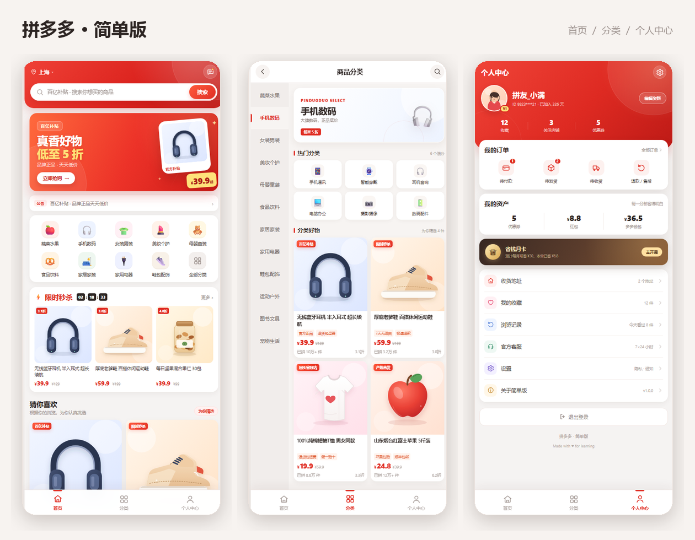
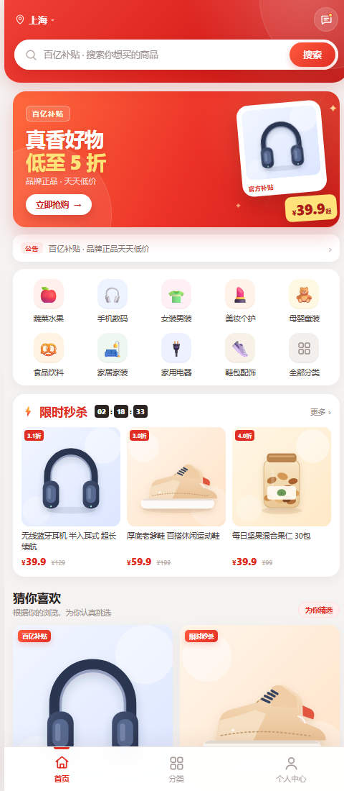
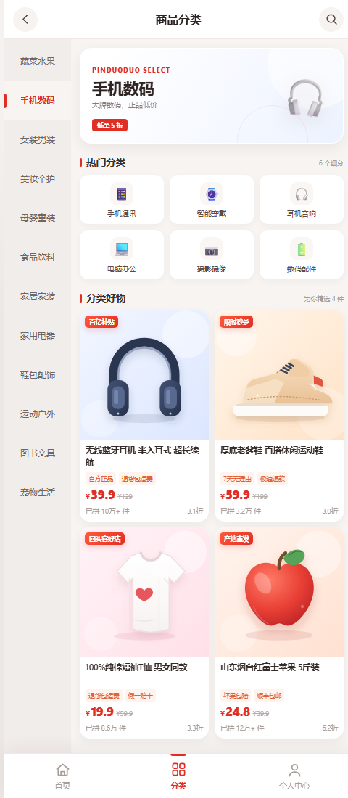
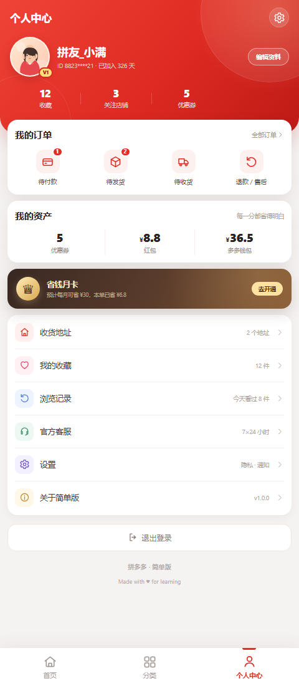

# 拼多多 · 简单版

一个**零依赖**的移动端拼多多风格 Demo，包含 **首页 / 分类 / 个人中心** 三个页面，并实现了 `GET /api/category` 分类接口。



> 仅用于前端练习与界面演示，非拼多多官方项目。

## 特性

- **三个完整页面**：首页、分类、个人中心，底部 Tab 可切换，移动端优先布局。
- **12 个商品分类**：蔬菜水果、手机数码、女装男装、美妆个护、母婴童装等，每类含 6 个二级分类。
- **12 件商品**：全部使用项目内手绘 SVG 插画，不依赖外链图片和图床。
- **真实接口**：`GET /api/category` 从同一份数据源返回分类 JSON。
- **可交互**：分类切换、商品搜索、商品详情半屏弹层、加入购物车提示、秒杀倒计时、Toast 提示。
- **零构建、零依赖**：Node.js 原生 `http` 模块 + 原生 HTML/CSS/JS，`npm install` 都不用跑。
- **静态降级**：直接静态托管 `public/` 时，接口不可用会自动使用内置分类数据，页面仍可正常浏览。
- **可访问性**：语义化标签、键盘可操作的商品卡片、焦点样式、`aria` 标注、减少动效偏好支持。

## 快速开始

要求：Node.js 18 及以上。

```bash
cd pinduoduo-demo
npm start
```

打开：

- 首页：<http://localhost:3000/>
- 分类：<http://localhost:3000/category>
- 个人中心：<http://localhost:3000/profile>
- 分类接口：<http://localhost:3000/api/category>

其他命令：

```bash
npm run dev   # Node --watch 热重启
npm test      # 接口、页面、静态资源与安全响应头测试
```

如需修改端口：

```powershell
$env:PORT=8080; npm start
```

## 页面预览

| 首页 | 分类 | 个人中心 |
| :---: | :---: | :---: |
|  |  |  |

| 搜索商品 | 商品详情 |
| :---: | :---: |
|  |  |

## 接口

### `GET /api/category`

返回全部 12 个一级分类，按页面展示顺序排列。

**响应示例：**

```json
{
  "code": 0,
  "message": "ok",
  "data": [
    {
      "id": "fruit",
      "name": "蔬菜水果",
      "icon": "🍎",
      "color": "#fff0eb",
      "blurb": "产地直发，新鲜到家",
      "children": ["时令水果", "新鲜蔬菜", "肉禽蛋品", "海鲜水产", "粮油调味", "乳品烘焙"]
    }
  ]
}
```

| 字段 | 类型 | 说明 |
| --- | --- | --- |
| `code` | `number` | `0` 表示成功 |
| `message` | `string` | 状态描述 |
| `data[].id` | `string` | 分类唯一标识，用于分类页 `?cat=` 参数 |
| `data[].name` | `string` | 分类名称 |
| `data[].icon` | `string` | 分类 Emoji 图标 |
| `data[].color` | `string` | 分类主题浅色背景 |
| `data[].blurb` | `string` | 分类文案 |
| `data[].children` | `string[]` | 二级分类名称 |

**状态码：**

- `200`：成功。
- `404`：接口不存在，返回 `{ "code": 404, "message": "接口不存在" }`。
- `405`：非 `GET/HEAD` 请求，`Allow: GET, HEAD`。

## 目录结构

```text
pinduoduo-demo/
├── server.js                  # 零依赖静态服务器 + /api/category
├── package.json
├── public/
│   ├── index.html             # 首页
│   ├── category.html          # 分类页
│   ├── profile.html           # 个人中心
│   ├── css/styles.css         # 全部样式
│   ├── js/
│   │   ├── catalog.js         # 分类/商品数据（浏览器与服务端共用）
│   │   └── app.js             # 页面渲染与交互
│   └── images/
│       ├── icons.svg          # SVG 图标 sprite
│       ├── avatar.svg
│       ├── favicon.svg
│       └── products/*.svg     # 12 张商品插画
├── test/server.test.js        # Node 原生测试
└── docs/screenshots/          # README 预览图
```

## 实现说明

- `public/js/catalog.js` 使用 UMD 写法：浏览器里挂到 `window.PDD_CATALOG`，Node 里 `require()`，避免接口和前端数据两份维护。
- 分类页先请求 `/api/category`，失败时自动回退到 `catalog.js` 的内置数据，因此静态托管也能用。
- 首页秒杀倒计时使用本地计时，不依赖后端；商品搜索为前端即时过滤。
- `server.js` 对静态文件做了路径穿越防护、MIME 类型、CSP 与基础安全响应头。
- 移动端最大宽度 480px，桌面端居中显示为手机画布。
- 所有图片均为本地 SVG，仓库可离线运行。

## 分支

当前开发分支：

```text
feature/sunba-homepage
```

## 发布到 GitHub

仓库已在本地初始化。添加远程仓库后推送：

```bash
git remote add origin https://github.com/<your-account>/<repo>.git
git push -u origin main
git push -u origin feature/sunba-homepage
```

### 静态部署说明

可以把 `public/` 目录直接部署到 GitHub Pages、Vercel、Netlify 等静态平台。页面会正常展示，`/api/category` 请求失败时自动使用内置分类数据。

如果希望 `GET /api/category` 真实可用，需要部署 `server.js`（Node 18+），例如 Railway、Render、Fly.io 或任意支持 Node 的服务器。

## License

[MIT](LICENSE)
